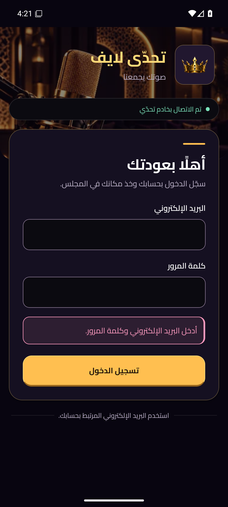

# Android native — visual evidence

Actual Android 16 / API 36 emulator screenshots, not generated mockups. No production account, password, cookie or token is shown. Gallery screens use explicitly labeled public static presentation fixtures; their audio is disconnected and writes are blocked. They do not prove live service operation.

## Iteration 1 — needs revision

Code: `1a2fbe1e84c404e6b2c07eae5534d4092e006d55`.
Gallery: [Actions run 39714063193](https://github.com/ziztp854-code/qurabia.com/actions/runs/39714063193), [executed reports](https://github.com/ziztp854-code/qurabia.com/actions/runs/39714063193/artifacts/12398139255).
Anonymous login after image: public APK run [39714068509](https://github.com/ziztp854-code/qurabia.com/actions/runs/39714068509), same code SHA. It shows empty-input validation, with both fields blank. Login before image comes from the preceding 0.2.2 public Android smoke at `7b18dfb859438a9ae46fbb78a480f65fd795604b`.

Measured display cases: 320dp = 960×1920px at density 480; 360dp = 1080×2160px at density 480; font scale 1.0. Anonymous before/after login: 1080×2400px. These are emulated native Android views; no desktop browser or physical-device visual acceptance is implied.

| State | 360dp | 320dp |
| --- | --- | --- |
| Home | [original PNG](iteration-1/current-360dp-home.png) | [original PNG](iteration-1/current-320dp-home.png) |
| Rooms | [original PNG](iteration-1/current-360dp-rooms.png) | [original PNG](iteration-1/current-320dp-rooms.png) |
| Profile | [original PNG](iteration-1/current-360dp-profile.png) | [original PNG](iteration-1/current-320dp-profile.png) |
| Voice room, disconnected | [original PNG](iteration-1/current-360dp-room.png) | [original PNG](iteration-1/current-320dp-room.png) |

[Search with keyboard](iteration-1/current-360dp-search-keyboard.png) · [Login before](iteration-1/anonymous-login-before.png) · [Login after](iteration-1/anonymous-login-after.png)

Root and the Android UI / Chat agents independently inspected these original frames. Observed blockers:

- Home/rooms: large header delays the first room name/host below the useful fold.
- Voice: the declared two messages have no visible list space; composer and microphone extend under the navigation rail on short screens.
- Search: the field is partly obscured by the IME; chat keyboard capture could not complete.
- Tablet and 2× font capture were not reached in this iteration. No acceptance score is assigned to missing evidence.

The next code revision reduces the header, promotes actual room artwork, adapts optional room controls to measured available height and keeps input above the keyboard. These fixes require new rendered evidence; source/typecheck alone does not validate them.

All images here are original emulator PNGs. No screenshot baseline was blindly updated, and no private authenticated UI XML/screenshots are included. APK files and functional results remain in Actions; no merge or production deployment was performed.

## 0.3.1 — معاينة الدخول الفعلية

الصورة التالية أصلية من محاكي Android36 / Pixel6، بدقة1080×2400، بعد نجاح فحوص الواجهة العامة الأربعة دون Metro في [التشغيل39720954765](https://github.com/ziztp854-code/qurabia.com/actions/runs/39720954765). البريد وكلمة المرور فارغان؛ المعروض هو تحقق محلي من الحقول الفارغة، وليس رفض حساب. لا توجد جلسة أو بيانات شخصية.

مصدر PR المدمج للاختبار `38670b4c3ed24f03310799c482e9e72d24280fab` له شجرة Git نفسها تمامًا `dd30037872153fd103cfdfc5f50d9ba7b34f8ae0` الخاصة بالرأس `eb1216d468453abc5b91ed2c36fad99878b17374`. الإصدار0.3.1، versionCode6. تسجيل الدخول بحساب وإغلاق الغرف والمصفوفة المرئية ما زالت معلقة في التشغيل الرئيسي عند حفظ هذه الصورة.

