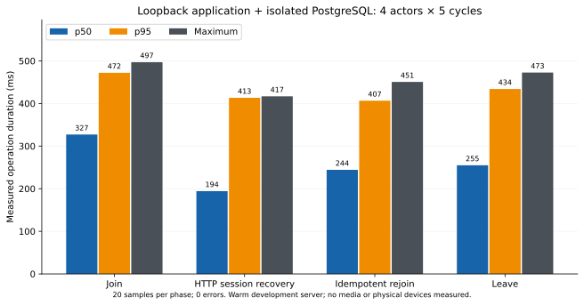

# Bounded room lifecycle load acceptance

Executed locally on 2026-10-21, after the full-suite and lifecycle-test resource windows. The measured application workload passed **80/80 operations**, with **0 errors**. No production server, account, database, push or deployment was used. No application audio code, rate limit or 45-second departure deadline was changed.

## Actual application HTTP and PostgreSQL

The runner used the existing Next.js 16.3.8 development server on **127.0.0.1:3117**, real NextAuth credentials sessions, existing room route handlers/controllers/repositories, and a fresh dedicated PostgreSQL 17 database named `voice_test_load_approval_*` on loopback port 55442. The integration agent applied all **32 current migration directories** to this isolated database before this run. Five temporary users were created directly in that database; all signed in through the real credentials callback and their authenticated session IDs were checked. No auth or membership fixture replaced the HTTP handlers. Existing application rate-limit guards remained active, using their development-local fallback with external Redis credentials blanked.

`MAMLUK_LOCAL_BUILD=1` selected `.next-mamluk` and prevented the root `.env` autoload. Fresh local auth secrets were stored outside the repository in a mode-0600 file and were not written to evidence. All LiveKit configuration was blanked explicitly. **Media was unavailable in this HTTP phase**: an HTTP leave success establishes membership removal, not microphone shutdown, SFU eviction or audible silence.

The bounded workload used one host and four concurrent actors, for five cycles. Each cycle performed four joins, four fresh HTTP-context recoveries using the same authenticated cookies, four idempotent rejoins and four leaves. This gives **20 measured operations per phase, 80 measured operations total**. Setup, route warmup and host assertions added 35 logical API calls, so 80 is not the total server request count. Next's normal trailing-slash redirects are included in the measured client durations. Each request retained a 45,000ms client upper bound; the measured workload had an overall 180,000ms safety bound.

HTTP-context recovery here means disposing a request context and reading the room with the same authenticated session from a new context. It does **not** simulate an interrupted WebRTC connection, an ICE restart, a page reload or an application `AudioSession` reconnect.

| Measured phase | Operations | Errors | p50 (ms) | p95 (ms) | Maximum (ms) |
| --- | ---: | ---: | ---: | ---: | ---: |
| Join | 20 | 0 | 327.2 | 472.0 | 497.0 |
| HTTP session recovery | 20 | 0 | 194.3 | 413.3 | 416.8 |
| Idempotent rejoin | 20 | 0 | 244.2 | 406.5 | 450.5 |
| Leave | 20 | 0 | 255.0 | 434.0 | 472.6 |

Measured duration was **7,544.3ms**. Percentiles use the nearest-rank method and include the four-request contention waves. The route modules were warmed before measurement; initial route compilation took approximately 1.5–1.9 seconds and is excluded. These small-sample local development measurements establish bounded lifecycle behavior for this workload; they do not establish production capacity, an end-user network SLA, cold-start latency or high-concurrency performance.



Evidence: [all 80 individual measurements and assertions](approval-load-api.json).

### Assertions and cleanup

- Every authenticated session resolved to its exact temporary user ID.
- Every join/rejoin checkpoint contained exactly the host plus the four distinct actors, with no duplicate participants.
- All five post-leave checkpoints contained **only the host**, both through the API and in persisted PostgreSQL room state. No departing actor remained in membership.
- Cleanup deleted only the exact owned room/user IDs and related preferences/reports; remaining owned room/user counts were zero.
- All Playwright HTTP request contexts were disposed and the Prisma client disconnected. No browser was started for this workload.
- The owned Next process was stopped, its launcher exited successfully, and a final loopback request to port 3117 failed with connection-refused (`curl` exit 7). The separate PostgreSQL container was left for the integration agent's centrally coordinated cleanup.
- The load runner's temporary external env file, including the local auth secret, was deleted after the run.

There were **no failed or skipped operations in this workload**. API-only evidence does not measure production `AudioSession` listeners, media sockets or timers; see the independent lifecycle and WebRTC evidence for those layers.

## Real WebRTC churn, separately measured

The independent WebRTC agent owns [the real local SFU transport result](approval-webrtc.md) and its [raw result](approval-webrtc-result.json). Its planned single transport run includes two independent native client processes, generated PCM, network-loss recovery and three bounded leave/rejoin cycles. No second competing SFU workload is needed for the same cycles. The transport results must be read from that report; this HTTP report does not predeclare them successful.

Raw SFU JWT admission is distinct from application-authenticated gateway membership. Generated PCM through an actual WebRTC transport is distinct from a physical microphone, speaker and human listening check. A production gateway revocation test, physical two-device audio and mobile keyboard acceptance remain outside this HTTP workload.

## Reproduction

Use a fresh loopback-only `voice_test_load_approval_*` database with the repository's migrations applied. Prepare a mode-0600 external env file containing `VOICE_LOAD_RUN=1`, `VOICE_TEST_DATABASE_URL` for that dedicated database, and a fresh `VOICE_LOAD_AUTH_SECRET` of at least 32 characters. The runners refuse other database host/name patterns. Never reuse a production or existing application database. Run the server and client serially in an exclusive resource window; no expensive suite, browser or SFU workload should compete with it.

Actual command forms for this run, from the repository root:

```sh
node --env-file=/tmp/voice-approval-load.env tests/voice-acceptance/load-api-server.mjs
node --env-file=/tmp/voice-approval-load.env --import tsx tests/voice-acceptance/load-api.mjs docs/visual-evidence/live-room-responsive/approval-load-api.json
python tests/voice-acceptance/load-chart.py docs/visual-evidence/live-room-responsive/approval-load-api.json docs/visual-evidence/live-room-responsive/approval-load-api-latency.svg
```

Stop the owned server process after the client finishes, verify port 3117 is closed, then remove the temporary database/container and secrets through the owner of that isolated environment. The 80-operation load ran **once**, passed without runner or application repairs, and was not repeated merely to collect timings.

## Acceptance boundary

Closed for this bounded workload: authenticated application join/rejoin/leave contention, membership return to the host baseline, persisted/API consistency, HTTP-context recovery, and exact test-resource cleanup. Unverified here: audio cessation, real-device behavior, application gateway revocation under real media, longer soak behavior and production-scale concurrency. Production readiness requires the other acceptance reports and explicit approval of any remaining critical risks.
